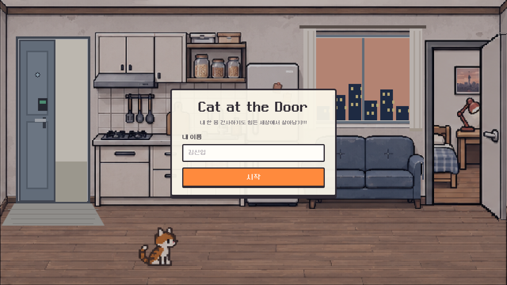
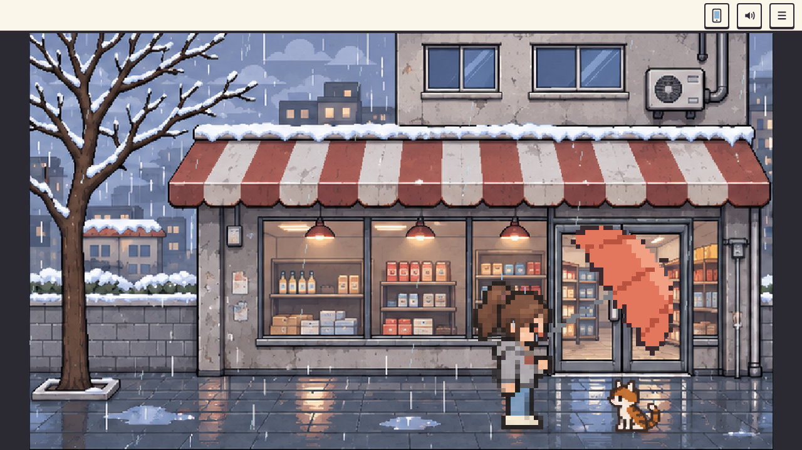
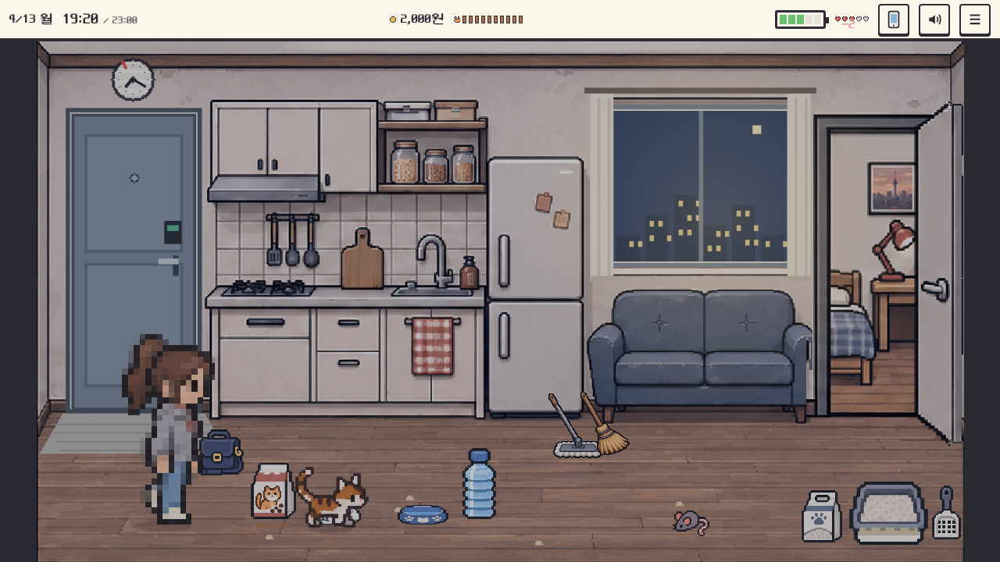
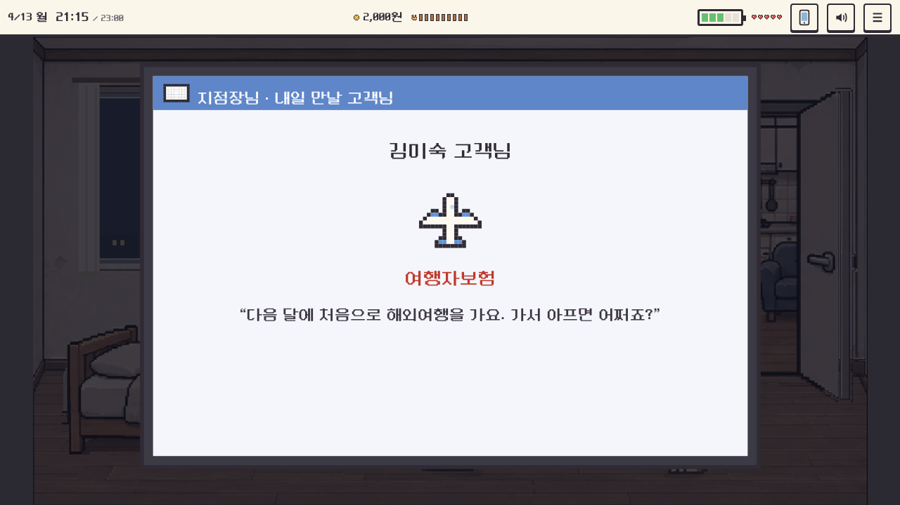
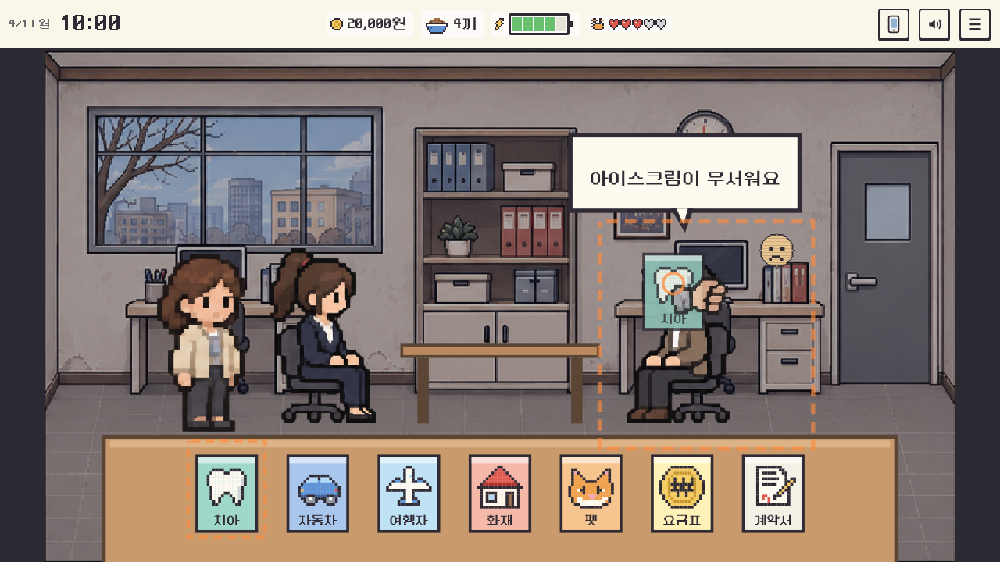
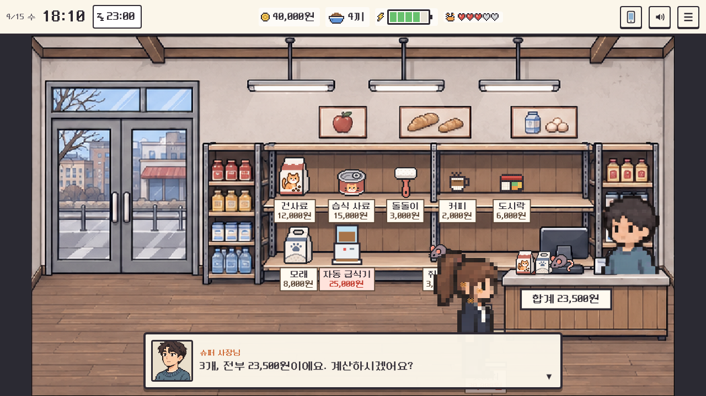
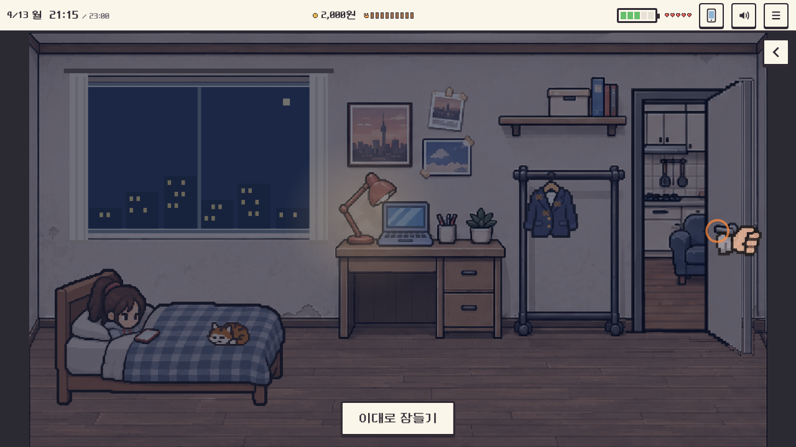
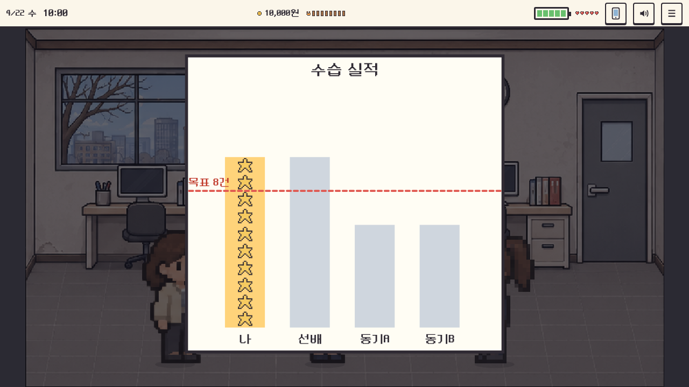
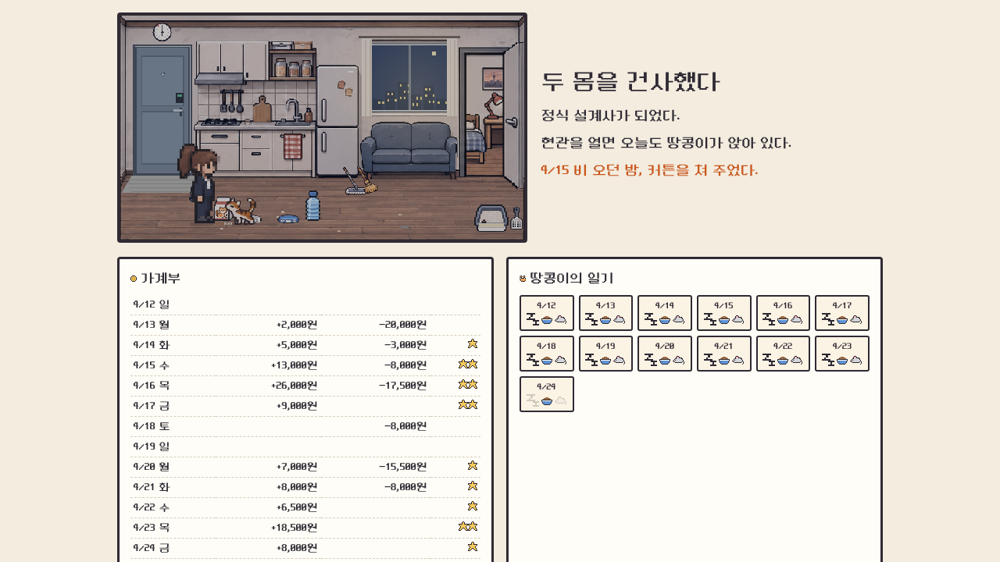

# 🐱 Cat at the Door v6

> 수습 기간 12일, 집에는 고양이 한 마리. 일도 고양이도 둘 다 챙길 수 있을까?

  <a href="https://kohyuji.github.io/cat-at-the-door/"><b>▶ 지금 플레이하기</b></a>
  &nbsp;·&nbsp;
  <a href="https://kohyuji.github.io/cat-at-the-door/downloads/Cat-at-the-Door.html">오프라인 한 파일 (약 22MB)</a>

인터랙티브 미디어 스토리텔링 수업에서 만든 픽셀아트 웹 게임입니다. 설치 없이 브라우저에서 바로 하고, PC의 크롬이나 엣지에서 마우스로 하는 것을 기준으로 만들었습니다.

## 이야기

4년째 취업을 준비하던 겨울, 또 한 번 불합격 문자를 받은 날. 비 오는 슈퍼 앞에서 쫄딱 젖은 고양이를 만나 우산을 기울여 줍니다. 그렇게 한 집에서 겨울을 보내고, 이듬해 봄 드디어 보험 설계사 수습으로 첫 출근을 합니다.

4월 13일부터 24일까지 계약 8건을 채우면 정식 설계사가 됩니다. 그런데 아침마다 정장에는 고양이 털이 붙어 있고, 저녁마다 고양이는 현관에서 기다립니다. 오늘 밤 방문을 열어 두고 같이 잘지, 닫고 혼자 잘지. 그 선택이 내일 아침 정장의 털과 고객의 표정으로 돌아옵니다.

## 스크린샷

| | |
| --- | --- |
|  |  |
| 프롤로그: 비 오는 슈퍼 앞에서 우산을 끌어 고양이를 씌워 줍니다. | 저녁: 밥, 물, 모래, 놀이. 시계는 일을 할 때마다 흐릅니다. |
|  |  |
| 전날 밤 메일로 내일 만날 고객의 메모가 옵니다. | 상담: 고객이 원하는 것을 보고 맞는 상품 카드를 냅니다. |
|  |  |
| 퇴근길 슈퍼: 사료, 모래, 장난감, 캣타워, 돌돌이, 커피. | 밤: 방문을 열어 둘지 닫을지 정하고 잠듭니다. |
|  |  |
| 계약하면 실적 그래프에 스티커가 붙습니다. 목표선은 8건. | 엔딩 7개. 12일 동안의 돈과 고양이의 하루가 함께 남습니다. |

## 이런 게임이에요

**하루는 시계로 흐릅니다.** 아침 7시 45분에 일어나 8시 10분 전에 집을 나서야 9시 조회에 맞습니다. 늦으면 기다리던 첫 고객이 그냥 돌아갑니다. 밥 주기, 모래 치우기, 옷 입기 같은 일마다 몇 분씩 걸리고, 피곤하면 더 오래 걸립니다. 정해진 취침 시간은 없지만 늦게 잘수록 다음 날 체력이 덜 찹니다.

**상담은 듣고 고르는 일입니다.** 고객이 말하는 것을 보고 맞는 상품 카드를 끌어다 줍니다. 틀린 카드를 내면 상담은 그 자리에서 끝납니다. 전날 밤 메일로 온 고객 메모를 읽고 가면 시작부터 분위기가 좋습니다. 첫 고객은 털 알레르기가 있어서, 털을 안 떼고 가면 계약을 놓칩니다.

**고양이도 하루가 있습니다.** 건사료와 습식 사료, 하루 한 번 갈아 주는 물, 며칠마다 갈아야 하는 모래, 쥐돌이 놀이와 쓰다듬기. 혼자 있는 낮이 길면 마음(♥)이 줄고, 캣타워를 사 주면 덜 줄어듭니다. 같이 자면 마음이 가까워지지만 정장에 털이 붙으니 아침에 돌돌이로 문질러 떼야 합니다. 4월 17일부터는 슈퍼에 로봇청소기와 자동 장난감이 들어옵니다. 깜빡해도 대신 해 주지만, 직접 할 때만큼 효과가 크지는 않습니다.

**주말과 사건.** 주말에는 청소하고, 낮잠을 자고, 장을 봅니다. 바닥의 털 뭉치는 빗자루로 쓸고(쌓이면 정장에 털이 붙음), 먼지 발자국은 대걸레로 닦습니다(쌓이면 고양이가 재채기). 돈이 모자라면 슈퍼에서 진열 알바를 할 수 있습니다. 네 시간에 5,000원이지만 몸이 고되고, 그동안 고양이는 혼자 기다립니다. 폭풍우 치는 저녁, 식당 사장님의 단체보험 문의, 아침에 고양이가 보이지 않는 날 같은 일이 끼어듭니다. 방문을 닫고 놀아 주지도 않은 밤에는 문 앞에 남은 고양이의 밤을 고양이 눈으로 봅니다.

**엔딩 7개.** 계약 8건을 채웠는지와 고양이와 얼마나 가까워졌는지에 따라 엔딩이 갈립니다. 밥그릇을 너무 자주 비우면 다른 끝이 기다립니다. 8건을 채우는 순간에는 지점에서 축하를 받고, 그 뒤 계약은 수당이 1.5배가 됩니다.

## 조작

- 걷기와 고르기: 바닥이나 물건을 클릭합니다. 처음 하는 일은 화살표와 손이 방법을 보여 줍니다.
- 대사 넘기기: 화면 아무 곳이나 클릭하거나 Enter, Space.
- 끌기: 우산 기울이기, 사료·물·모래 붓기, 똥 치우기, 쥐돌이 흔들기, 쓰다듬기, 돌돌이 문지르기, 청소, 커튼, 방문 열고 닫기는 누른 채 움직입니다. 상담에서는 상품 카드를 고객에게 끌어다 줍니다.
- 오른쪽 위: 휴대폰(문자와 메일), 소리, ☰ 메뉴(이어하기, 처음부터).
- 저장: 주요 장면마다 브라우저에 자동으로 저장됩니다.

## 업데이트 기록

| 단계 | 버전 | 무엇이 달라졌나 |
| --- | --- | --- |
| 1 | **같이 잘까? 말까?** (첫 프로토타입) | 텍스트 위주. 문 밑 고양이 눈빛, 10일 밤 선택, 연봉 증감, 월급날 사료 고르기와 4가지 결말로 핵심 구조를 확인 |
| 2 | **같이 잘까?** (픽셀아트 버전) | 둥근모꼴 픽셀 폰트, SVG로 그린 방·회사 장면, 이름 입력, 비 오는 밤 같은 이벤트와 엔딩 확장 |
| 3 | **Cat at the Door** | 제목 변경. 어젯밤과 비교하는 멘트, 아침 고양이 행동 기억, 돌돌이 선택, 팀장님 표정 옆 '체면' 표시, 말풍선 개선 |
| 4 | **Cat at the Door v4** (서사 업그레이드) | 프롤로그 3장면, 거절할 때의 '망설임 3초', 곁가지 사건, 엔딩 7개, 고양이 시점 에필로그 "문 너머의 열 밤" |
| 4.1 | **돌돌이 드래그** | 돌돌이를 버튼 대신 정장 위를 직접 문질러 미는 조작으로 변경 |
| 5 | **두 갈래 실험** (claude-v5, codex-v5) | 같은 기획을 Claude와 ChatGPT(Codex)가 각각 다시 만든 판. 수습 설계사의 12일과 새 픽셀아트 |
| 6 | **Cat at the Door v6** | codex-v5의 그림 위에 핵심 규칙을 새로 짜고 세 차례 플레이 피드백으로 다듬은 판. 시계로 흐르는 하루, 고객 메모 메일, 상담 카드, 털 알레르기 첫 고객, 청소와 낮잠, 주말 슈퍼 알바, 캣타워·자동 급식기·로봇청소기·자동 장난감, 8건 달성 축하 |

### 이전 판 플레이

- v4.1: https://kohyuji.github.io/cat-at-the-door/v4.1/ (itch.io: https://kohyuji.itch.io/cat-at-the-door)
- v5 실험: [claude-v5](https://kohyuji.github.io/cat-at-the-door/claude-v5/) · [codex-v5](https://kohyuji.github.io/cat-at-the-door/codex-v5/) · [codex-v5-claude](https://kohyuji.github.io/cat-at-the-door/codex-v5-claude/) (v6 직전 작업본)
- 예전 코드와 기획 자료는 [`archive/`](archive/)에, v5 실험 코드는 각 브랜치에 있습니다.

## 만든 사람들

- 기획, 플레이 테스트, 피드백: 코휴지 ([@kohyuji](https://github.com/kohyuji))
- 픽셀아트: ChatGPT(Codex)가 그린 R4·R6 그림을 바탕으로 썼습니다. 어느 그림을 어디서 가져왔는지는 [`assets/README.md`](assets/README.md)와 `assets/*-asset-manifest.json`에 있습니다.
- 코드와 밸런스: Claude (Claude Code)
- 글꼴: Neo둥근모 Pro, 둥근모꼴 ([`assets/fonts/`](assets/fonts/))

## 디벨롭 계획

- [] 주말 컨텐츠 추가
- [] 배경음악 추가
- [] 작은 사건들 추가해서 스토리 보강
- [] 청소 컨텐츠 보강
- [] 로봇청소기, 자동 장난감 등 아이템 추가
