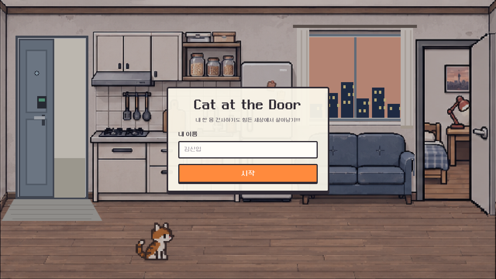
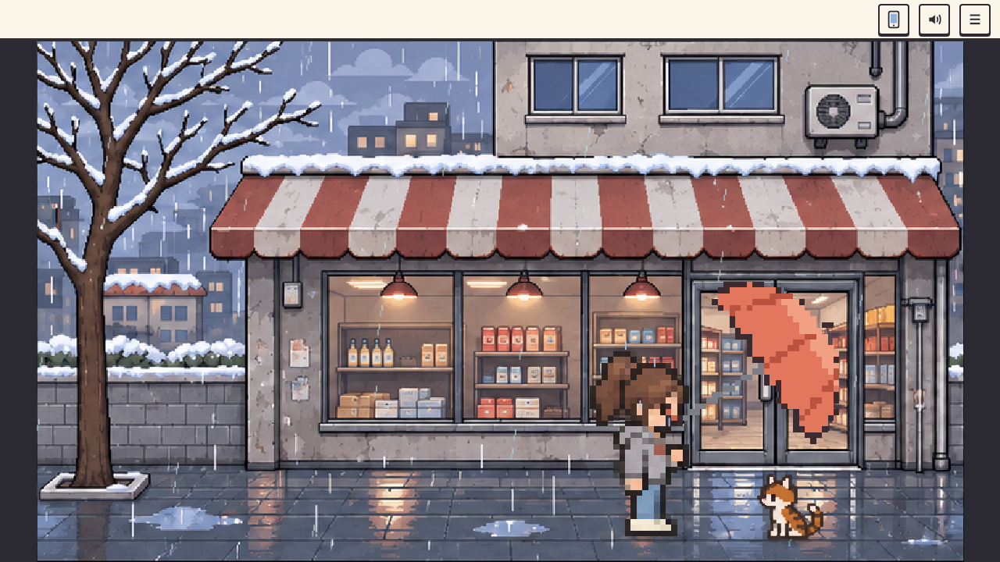
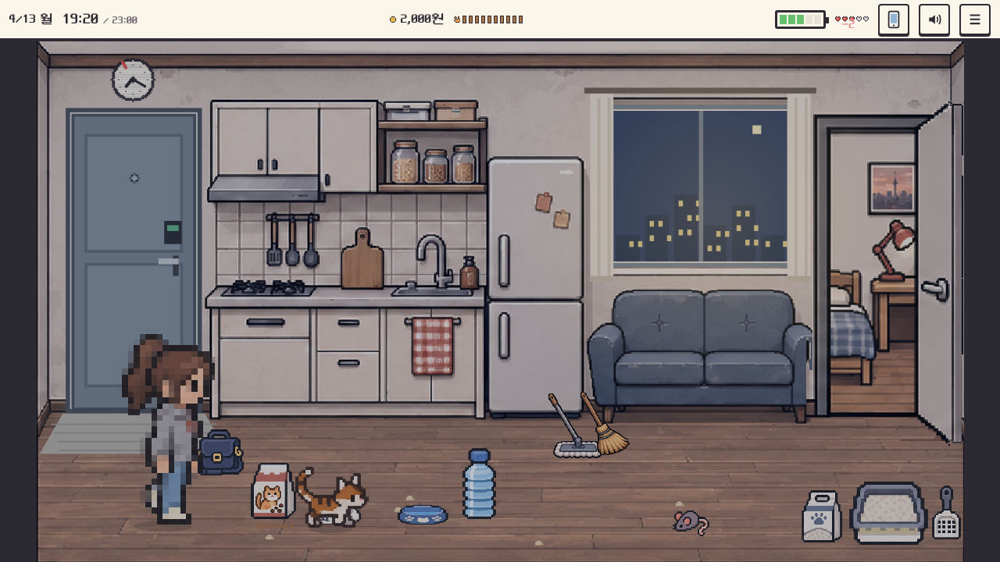
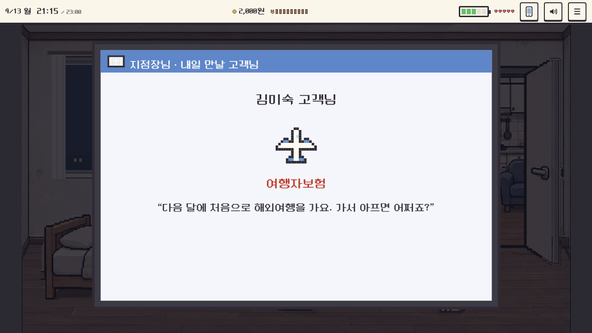
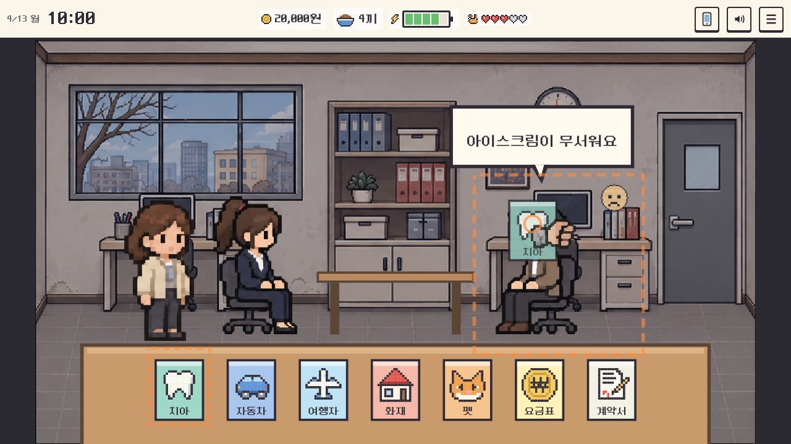
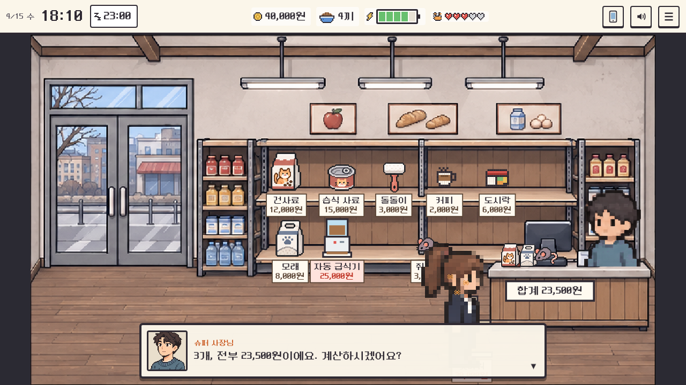
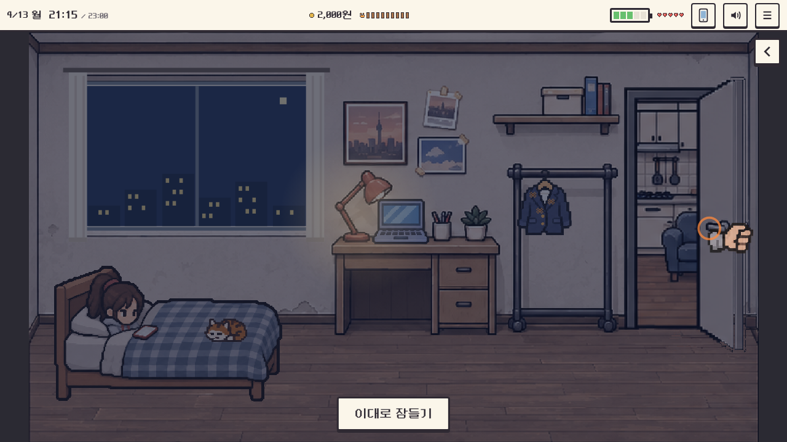
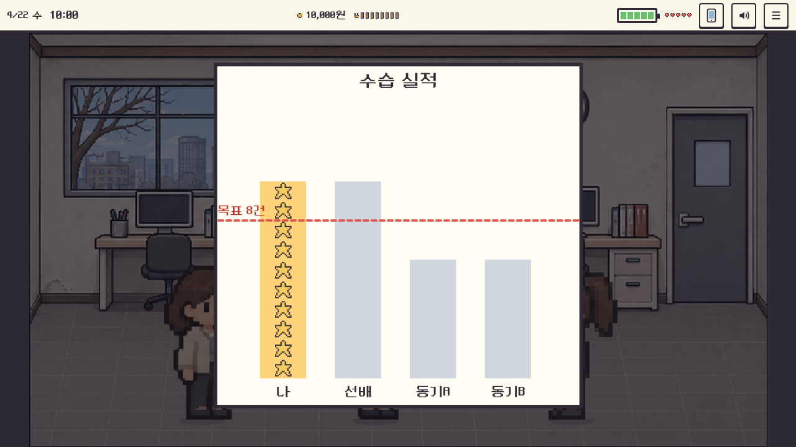
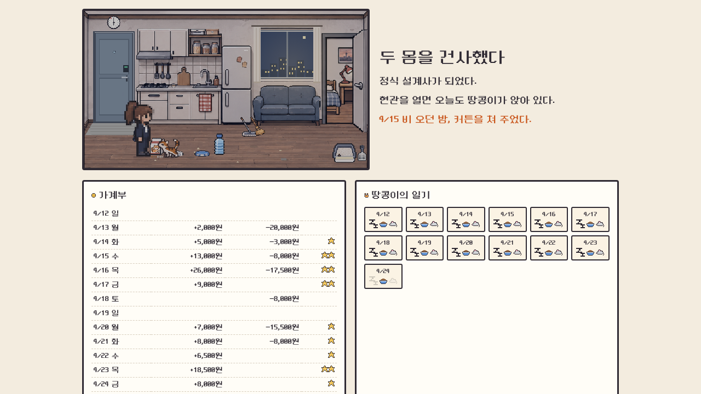

# 🐱 Cat at the Door v6.4

> 수습 기간 12일, 집에는 고양이 한 마리. 일도 고양이도 둘 다 챙길 수 있을까?

  <a href="https://kohyuji.github.io/cat-at-the-door/"><b>▶ 지금 플레이하기</b></a>
  &nbsp;·&nbsp;
  <a href="https://kohyuji.github.io/cat-at-the-door/downloads/Cat-at-the-Door.html">오프라인 한 파일 (약 22MB)</a>

인터랙티브 미디어 스토리텔링 수업에서 만든 픽셀아트 웹 게임입니다. 설치 없이 브라우저에서 바로 하고, PC의 크롬이나 엣지에서 마우스로 하는 것을 기준으로 만들었습니다.

## 이야기

4년째 취업을 준비하던 겨울, 또 한 번 불합격 문자를 받은 날. 비 오는 슈퍼 앞에서 쫄딱 젖은 고양이를 만나 우산을 기울여 줍니다. 그렇게 한 집에서 겨울을 보내고, 이듬해 봄 드디어 보험 설계사 수습으로 첫 출근을 합니다.

4월 13일부터 24일까지 계약 12건을 채우면 정식 설계사가 됩니다. 그런데 아침마다 정장에는 고양이 털이 붙어 있고, 저녁마다 고양이는 현관에서 기다립니다. 오늘 밤 방문을 열어 두고 같이 잘지, 닫고 혼자 잘지. 그 선택이 내일 아침 정장의 털과 고객의 표정으로 돌아옵니다.

내 한 몸 건사하기도 벅찬데 둘이 되면 더 무겁습니다. 그런데 둘이라서 나아지는 것도 있습니다. 새벽 다섯 시에 얼굴을 밟던 발이 어느 아침에는 고장 난 알람 대신 나를 깨우고, 지하철에서 몰래 떼던 소매의 털 한 가닥이 고양이를 키우는 고객 앞에서는 이야기를 열어 줍니다. 이 게임은 일과 나의 삶, 그리고 고양이 사이에서 균형을 잡는 열이틀입니다.

## 스크린샷

| | |
| --- | --- |
|  |  |
| 프롤로그: 비 오는 슈퍼 앞에서 우산을 끌어 고양이를 씌워 줍니다. | 저녁: 밥, 물, 모래, 놀이. 위쪽 큰 시계는 일을 할 때마다 흐릅니다. |
|  |  |
| 전날 밤 메일로 내일 만날 고객의 메모가 옵니다. | 상담: 고객의 이야기를 듣고 맞는 상품 카드를 끌어다 줍니다. 첫 상담은 손이 먼저 보여 줍니다. |
|  |  |
| 슈퍼: 고른 물건을 계산대에 올리고 사장님께 계산합니다. 밤 11시가 넘으면 심야 할증. | 밤: 방문을 열어 둘지 닫을지 정하고 잠듭니다. |
|  |  |
| 계약하면 실적 그래프에 스티커가 붙습니다. 목표선은 12건. | 엔딩 9개. 굿·노멀·배드·히든 등급과 엔딩 도감, 12일 동안의 가계부와 고양이의 일기가 남습니다. |

## 이런 게임이에요

**하루는 시계로 흐릅니다.** 아침 7시 40분에 일어나 8시 10분 전에 집을 나서야 지하철 50분을 타고 9시 조회에 맞습니다. 화면 위 시계 옆에 집을 나설 시각과 남은 분, 지금 나가면 몇 시에 도착하는지가 늘 떠 있습니다. 늦으면 기다리던 첫 고객이 그냥 돌아갑니다. 밥 주기, 모래 치우기, 옷 입기 같은 일마다 몇 분씩 걸리고, 피곤하면 더 오래 걸립니다. 정해진 취침 시간은 없지만 늦게 잘수록 다음 날 체력이 덜 찹니다.

**상담은 듣고 고르는 일입니다.** 첫 출근 전날 밤 지점장님이 문자로 이 일이 무엇인지 알려 주고, 첫날 조회에서 상품 안내서를 하나씩 보여 줍니다. 고객은 무엇을 원하는지 바로 말하지 않고 사는 이야기를 합니다("요즘 아이스크림을 못 먹어요"). 이야기를 듣고 맞는 상품 카드를 끌어다 줍니다. 틀린 카드를 내면 기분이 상하고 조금 더 분명하게 다시 말해 주지만, 두 번 틀리면 상담이 끝납니다. 전날 밤 메일로 온 고객 메모를 읽고 가면 무엇을 찾는지 미리 알고, 실수 하나쯤은 버틸 수 있습니다. 평일마다 오전 10시와 오후 2시에 고객이 한 분씩 와서, 늦어도 오후 고객은 만납니다. 첫 고객은 털 알레르기가 있어서, 털을 안 떼고 가면 계약을 놓칩니다. 모래를 안 치우고 나가면 옷에 냄새가 배어 조회 때 지점장님이 먼저 알아채고, 고객이 코를 찡그립니다.

**고양이도 하루가 있습니다.** 건사료와 습식 사료, 하루 한 번 갈아 주는 물, 며칠마다 갈아야 하는 모래(떨어지면 똥도 못 치웁니다), 쥐돌이 놀이와 쓰다듬기. 정장을 입은 채 쓰다듬으면 털이 붙고, 그 털은 지하철에서도 슈퍼에서도 그대로입니다. 혼자 있는 낮이 길면 마음(♥)이 줄고, 캣타워를 사 주면 덜 줄어듭니다. 같이 자면 마음이 가까워지지만 정장에 털이 붙으니 아침에 돌돌이로 문질러 떼야 합니다. 4월 17일부터는 슈퍼에 로봇청소기와 자동 장난감이 들어옵니다. 깜빡해도 대신 해 주지만, 직접 할 때만큼 효과가 크지는 않습니다.

**주말과 사건.** 주말에는 청소하고, 낮잠을 자고, 장을 봅니다. 바닥의 털 뭉치는 빗자루로 쓸고(쌓이면 정장에 털이 붙음), 먼지 발자국은 대걸레로 닦습니다(쌓이면 고양이가 재채기). 돈이 모자라면 토요일이나 일요일에 슈퍼에서 진열 알바를 할 수 있습니다. 네 시간에 5,000원이지만 몸이 고되고, 그동안 고양이는 혼자 기다립니다. 저녁에도 슈퍼에는 몇 번이든 다시 갈 수 있지만, 밤 11시가 넘으면 값이 1.5배가 됩니다. 폭풍우 치는 저녁(커튼을 쳐 주지 않으면 고양이가 혼자 떱니다), 식당 사장님의 단체보험 문의, 아침에 고양이가 보이지 않는 날(못 찾고 나가면 고양이는 하루 종일 서랍에 갇혀 있습니다) 같은 일이 끼어듭니다. 방문을 닫고 놀아 주지도 않은 밤에는 문 앞에 남은 고양이의 밤을 고양이 눈으로 봅니다.

**둘이라서: 열이틀의 기승전결.** 사건은 플레이어가 무엇을 하든 그날 꼭 일어나고, 손으로 한 일이 그 결과를 바꿉니다.

| | 날 | 일어나는 일 | 플레이어가 바꾸는 것 |
| --- | --- | --- | --- |
| 기 | 4/13~15 | 첫 출근과 털, 내 저녁 챙기기, 새벽 꾹꾹이, 천둥 치는 밤 | 꾹꾹이를 쓰다듬어 받아 주면 마음 +1 체력 −1, 이불을 덮어쓰면 마음 −1. 커튼을 쳐 주면 천둥 밤을 같이 넘깁니다 |
| 승 | 4/16~20 | 4/17 실적이 바닥인 금요일, 동기들 저녁, 엄마 문자. 주말. 4/20 알람이 고장 난 아침 | 저녁에 가면 소개 계약 한 건, 대신 늦게 들어갑니다. 4/20에는 마음이 가까우면(♥3 이상) 고양이가 깨워 주고, 아니면 늦잠으로 첫 고객을 놓칩니다 |
| 전 | 4/21~23 | 4/21 고양이를 키우는 고객, 4/22 야근 권유, 4/23 발표 준비 중 자판 위에 앉은 고양이 | 사진이 두 장 넘으면 고객과 이야기가 풀립니다. 남아서 한 건 더 하면 고양이는 현관에서 기다리다 잠듭니다. 고양이를 옆으로 옮기면 발표 준비가 끝나고, 노트북을 덮으면 같이 놉니다 |
| 결 | 4/24 | 평가, 그리고 프롤로그처럼 비 오는 귀갓길 | 같은 슈퍼 앞에서 같은 우산을 폅니다. 엔딩에서 계약 그래프와 내가 찍은 사진첩을 나란히 봅니다 |

**새 손짓 셋.** 저녁과 주말에 고양이가 반짝이는 얼굴을 하면 몇 초 안에 눌러 휴대폰 사진으로 남깁니다(평일 두 장, 주말 세 장까지). 부엌의 삼각김밥(5분)이나 가스레인지(40분, 그날 밤 체력 +1)로 내 저녁도 챙깁니다. 굶고 자면 체력이 한 칸 덜 찹니다. 같이 잔 밤 몇 번은 새벽 다섯 시에 꾹꾹이가 찾아옵니다.

**일은 하나씩 늘어납니다.** 냉장고의 돌봄 메모도 한 번에 다 알려 주지 않고, 그 일이 처음 생기는 날 한 줄씩 늘어납니다(새 줄이 생기면 메모가 빛납니다). 첫날은 밥, 물, 옷과 털뿐입니다. 털 때문에 첫 고객을 놓친 다음 날 돌돌이가 생기고, 사흘째(4/14)부터 화장실 똥과 바닥 털 뭉치(빗자루)가, 4/16부터 먼지 발자국(대걸레)이 생깁니다. 모래는 4/15 무렵에야 갈 때가 됩니다.

**장소마다 배경음악.** 겨울비의 프롤로그, 바쁜 아침, 덜컹이는 지하철, 지점과 째깍대는 상담, 퇴근길과 슈퍼, 따뜻한 저녁과 느긋한 주말, 천둥 치는 밤, 자장가 같은 잠자리, 마지막 날의 빗길까지 장소와 때에 따라 곡이 바뀝니다. 오른쪽 위 소리 버튼으로 끌 수 있습니다.

**엔딩 8개.** 계약 12건을 채웠는지, 고양이와 얼마나 가까워졌는지, 둘이 보낸 순간을 몇 장이나 남겼는지에 따라 굿, 노멀, 배드 엔딩이 갈립니다. 일만 챙겨도, 고양이만 챙겨도 굿 엔딩은 나오지 않습니다. 사건이 있던 날까지 다 지켜 내고 사진첩을 가득 채운 사람에게만 히든 엔딩이 열립니다. 밥그릇을 너무 자주 비우면 다른 끝이 기다립니다. 찾은 엔딩은 엔딩 도감에 남고, 못 찾은 엔딩은 힌트만 보입니다. 12건을 채우는 순간에는 지점에서 축하를 받고, 그 뒤 계약은 수당이 1.5배가 됩니다.

## 조작

- 걷기와 고르기: 바닥이나 물건을 클릭합니다. 처음 하는 일은 화살표와 손이 방법을 보여 줍니다. 걸어가는 도중에 다른 곳을 누르면 하던 일은 취소하고 새로 누른 곳으로 갑니다. 누를 수 있는 사람과 물건은 마우스를 대면 테두리가 빛납니다.
- 대사 넘기기: 화면 아무 곳이나 클릭하거나 Enter, Space.
- 끌기: 우산 기울이기, 사료·물·모래 붓기, 똥 치우기, 쥐돌이 흔들기, 쓰다듬기, 돌돌이 문지르기, 청소, 커튼, 방문 열고 닫기, 마지막 날 우산 펴기는 누른 채 움직입니다. 반짝이는 고양이는 눌러서 사진을 찍습니다. 상담에서는 상품 카드를 고객에게 끌어다 줍니다.
- 오른쪽 위: 휴대폰(문자와 메일), 소리, ☰ 메뉴(이어하기, 처음부터).
- 저장: 주요 장면마다 브라우저에 자동으로 저장됩니다.

### 개발자 모드 (시험용)

주소 끝에 `?dev`를 붙이면 처음 화면에 개발자 모드가 나옵니다. 예: https://kohyuji.github.io/cat-at-the-door/v6.4/?dev

- 어디서 시작: 4/13부터 4/24까지 날마다 출근 아침, 퇴근 후 저녁(주말은 아침)을 고르면 그 장면부터 바로 시작합니다.
- 그때까지 플레이: 건너뛴 날들을 일도 고양이도 / 일만 / 고양이만 중 어떤 방식으로 보냈는지 고르면 돈, 계약, 하트, 사진, 사료가 그 방식대로 남아 있습니다.
- 게임 중 왼쪽 아래 DEV 단추: 하트, 체력, 돈, 계약, 사진, 시간을 바로 바꾸고, 날짜 고르기로 돌아갑니다.

## 업데이트 기록

| 단계 | 버전 | 무엇이 달라졌나 |
| --- | --- | --- |
| 1 | **같이 잘까? 말까?** (첫 프로토타입) | 텍스트 위주. 문 밑 고양이 눈빛, 10일 밤 선택, 연봉 증감, 월급날 사료 고르기와 4가지 결말로 핵심 구조를 확인 |
| 2 | **같이 잘까?** (픽셀아트 버전) | 둥근모꼴 픽셀 폰트, SVG로 그린 방·회사 장면, 이름 입력, 비 오는 밤 같은 이벤트와 엔딩 확장 |
| 3 | **Cat at the Door** | 제목 변경. 어젯밤과 비교하는 멘트, 아침 고양이 행동 기억, 돌돌이 선택, 팀장님 표정 옆 '체면' 표시, 말풍선 개선 |
| 4 | **Cat at the Door v4** (서사 업그레이드) | 프롤로그 3장면, 거절할 때의 '망설임 3초', 곁가지 사건, 엔딩 7개, 고양이 시점 에필로그 "문 너머의 열 밤" |
| 4.1 | **돌돌이 드래그** | 돌돌이를 버튼 대신 정장 위를 직접 문질러 미는 조작으로 변경 |
| 5 | **두 갈래 실험** (claude-v5, codex-v5) | 같은 기획을 Claude와 ChatGPT(Codex)가 각각 다시 만든 판. 수습 설계사의 12일과 새 픽셀아트 |
| 6 | **Cat at the Door v6** | codex-v5의 그림 위에 핵심 규칙을 새로 짜고 세 차례 플레이 피드백으로 다듬은 판. 시계로 흐르는 하루, 고객 메모 메일, 상담 카드, 털 알레르기 첫 고객, 청소와 낮잠, 주말 슈퍼 알바, 캣타워·자동 급식기·로봇청소기·자동 장난감, 8건 달성 축하 |
| 6.1 | **친구 플레이 테스트 반영** | 크고 하나뿐인 시계와 출근 마감 표시, 첫 상담·쓰다듬기·쥐돌이 놀이 안내, 지점장님 문자와 첫날 고객 두 분, 슈퍼 계산대와 심야 할증, 모래와 똥 냄새, 서랍에 갇힌 고양이, 다른 곳을 누르면 하던 행동 취소, 엔딩 등급과 도감. 이어서 평일마다 고객 두 분과 목표 12건, 사는 이야기로 바꾼 고객 힌트, 냄새에 반응하는 지점장님과 선배 |
| 6.3 | **배경음악과 일의 순서** | 장소마다 바뀌는 배경음악 13곡, 일을 하루씩 늘려 가는 순서(화장실과 바닥 청소는 4/14부터, 먼지는 4/16부터) |
| 6.4 | **둘이라서** | 일과 삶의 균형을 따라가는 열이틀의 기승전결(새벽 꾹꾹이, 4/17 금요일과 엄마 문자, 4/20 알람, 4/21 고양이를 키우는 고객, 4/22 야근, 4/23 자판 위의 고양이, 4/24 비 오는 귀갓길), 사진 찍기와 사진첩, 내 저녁, 하루씩 늘어나는 돌봄 메모, 가는 털 가닥으로 다시 그린 옷의 털, 시험용 개발자 모드(`?dev`) |

### 이전 판 플레이

- v4.1: https://kohyuji.github.io/cat-at-the-door/v4.1/ (itch.io: https://kohyuji.itch.io/cat-at-the-door)
- v5 실험: [claude-v5](https://kohyuji.github.io/cat-at-the-door/claude-v5/) · [codex-v5](https://kohyuji.github.io/cat-at-the-door/codex-v5/) · [codex-v5-claude](https://kohyuji.github.io/cat-at-the-door/codex-v5-claude/) (v6 직전 작업본)
- 예전 코드와 기획 자료는 [`archive/`](archive/)에, v5 실험 코드는 각 브랜치에 있습니다.

## 만든 사람들

- 기획, 플레이 테스트, 피드백: 코휴지 ([@kohyuji](https://github.com/kohyuji))
- 픽셀아트: ChatGPT(Codex)가 그린 R4·R6 그림을 바탕으로 썼습니다. 어느 그림을 어디서 가져왔는지는 [`assets/README.md`](assets/README.md)와 `assets/*-asset-manifest.json`에 있습니다.
- 코드와 밸런스: Claude (Claude Code)
- 글꼴: Neo둥근모 Pro, 둥근모꼴 ([`assets/fonts/`](assets/fonts/))

## 디벨롭 계획

- [x] 주말 컨텐츠 추가 (v6 주말 슈퍼 알바, 낮잠)
- [x] 배경음악 추가 (v6.3 장소별 13곡)
- [x] 작은 사건들 추가해서 스토리 보강 (v6.4 둘이라서: 열이틀의 기승전결)
- [x] 청소 컨텐츠 보강 (빗자루와 대걸레, v6.3에서 4/14부터 하나씩)
- [x] 로봇청소기, 자동 장난감 등 아이템 추가 (v6)
