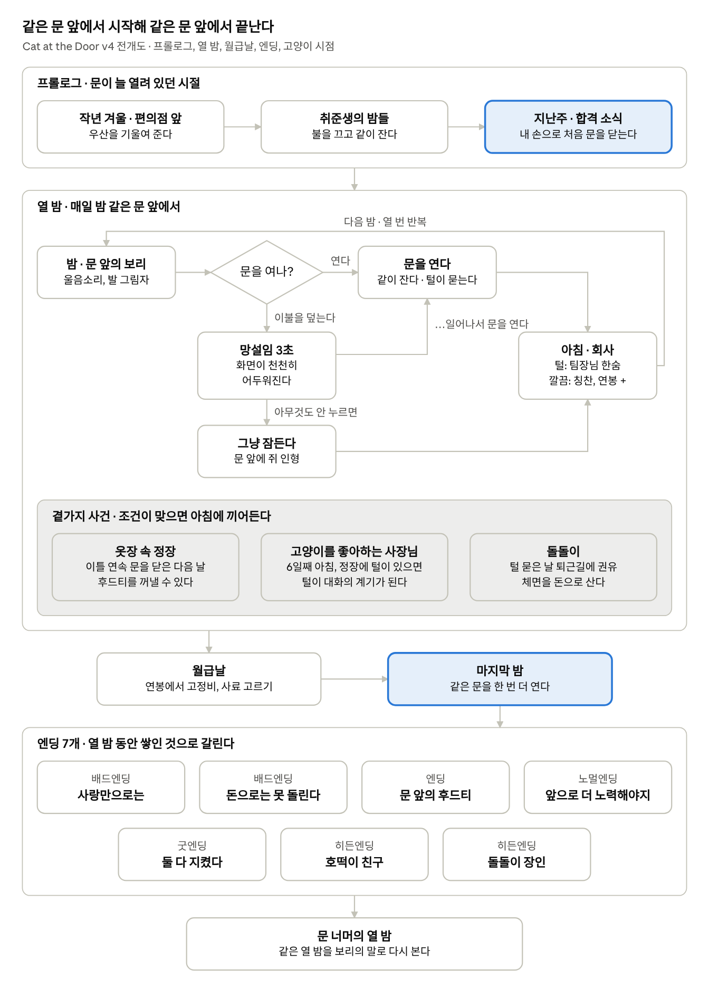

# Cat at the Door v4 기획서

2026-10-26 · 코휴지 · 스토리텔링의 확장 인터랙티브 미디어 워크샵 2

## 한눈에 보기

v4는 "오늘 밤 고양이와 같이 잘까"라는 하나의 선택은 그대로 두고, 그 선택이 열흘 동안 쌓여 한 사람과 한 고양이의 이야기가 되도록 앞뒤를 채운 버전이다. 직접 해 보기: https://kohyuji.github.io/cat-at-the-door/

| 부분 | v3 | v4 |
| --- | --- | --- |
| 시작 | 이름을 넣으면 바로 첫 밤 | 프롤로그 3장면: 취준 시절 비 오는 밤 보리를 만남, 문이 늘 열려 있던 날들, 합격 뒤 내 손으로 방문을 닫음 |
| 거절 | "그냥 잔다" 버튼 한 번 | "이불을 머리끝까지 덮는다"를 누르면 화면이 약 3초 동안 어두워지고, 그사이 아직 일어나 문을 열 수 있음 |
| 곁가지 사건 | 돌돌이 | 돌돌이 + 옷장 속 정장, 회색 후드티, 고양이를 좋아하는 사장님, 문틈으로 쌓이는 쥐 인형 |
| 마지막 | 사료를 고르면 바로 엔딩 | 월급날 밤에 처음과 같은 '방문 열기'를 한 번 더 하고, 그 결과가 엔딩이 됨 |
| 엔딩 | 5개 | 7개 + 내가 실제로 한 선택 하나를 다시 떠올리게 하는 한 줄 |
| 엔딩 뒤 | 다시 하기 | 같은 열 밤을 보리 쪽에서 다시 보는 "문 너머의 열 밤" |

그대로 둔 것: 열흘 구조, 연봉과 체면 표정, 월급날 사료 고르기, 돌돌이, 픽셀 그림체와 둥근모꼴, 이름 입력, "어제보다 소리가 작다" 같은 비교 멘트와 아침 고양이 기억(v3에서 받은 피드백).

## 강의계획서와의 연결

강의계획서가 강조하는 것은 "관객의 행동이 이야기의 변화가 되는 구조"이다. v4는 문 하나를 열고 닫는 행동에 주차별 주제를 하나씩 걸었다.

| 주차 | 강의 주제 | v4에서 해당하는 부분 |
| --- | --- | --- |
| 3주 | 게임의 상호작용: 입력, 움직임, 공간 | 침실 안과 문 밖이라는 두 공간, 그 경계가 문 |
| 4주 | 선택, 트리거, 네비게이션 | 문 열기와 이불 덮기, 조건이 맞을 때만 일어나는 옷장·사장님 사건 |
| 5주 | 생성형 AI와 창작 사고 | 이 기획서의 제안 중 남길 것과 버릴 것을 직접 골라 기록 (Day01의 사람·AI 역할 나누기) |
| 6주 | 설계1: 결핍과 행동 | 주인공은 첫 직장에서 인정받고 싶고, 보리는 문 너머의 온기가 필요하다. 두 결핍이 매일 밤 같은 문 앞에서 부딪힘 |
| 7주 | 설계2: 트리거와 분기 | 이틀 연속 닫으면 옷장 사건, 6일째 아침 털이 있느냐에 따라 사장님 사건이 갈림, 엔딩 7개 |
| 9주 | 하이브리드 미디어와 공간 경험 | 문틈의 빛, 발 그림자, 문 앞에 쌓이는 쥐 인형처럼 공간에 남는 흔적 |
| 10주 | 몰입형 서사 | 프롤로그에서 문이 늘 열려 있던 시절을 먼저 겪게 해, 첫 밤의 닫힌 문이 낯설게 느껴지도록 |
| 11주 | 반복과 관점 변화 | 같은 문 열기를 열 번 반복하며 의미가 바뀌고, 엔딩 뒤 보리 쪽에서 같은 열 밤을 다시 봄 |
| 12주 | 프로토타입 설계1: 핵심 상호작용 | 거절할 때의 '망설이는 3초' |
| 13주 | 공간과 피드백 | 울음소리, 배웅, 쥐 인형처럼 숫자 대신 장면으로 주는 피드백 |
| 14~15주 | 시연과 수정, 최종 발표 | 마지막 절의 '관객에게 물어볼 질문'으로 시연 준비 |

수업에서 본 작품들의 로직이나 소재는 가져오지 않고, 감정을 전달하는 원리만 우리 상황에 맞게 옮겼다.

| 작품 | 가져온 원리 | v4에서의 모습 |
| --- | --- | --- |
| Florence | 감정을 설명하지 말고 수행하게 한다, 같은 조작을 다른 맥락에서 다시 쓴다 | '외면하는 마음'을 문장 대신 어두워지는 3초로, 마지막 밤에 같은 문 열기를 한 번 더 |
| Papers, Please | 결과가 결정 뒤에도 보이고, 여러 엔딩이 앞의 선택을 다시 보게 한다 | 문 앞에 쌓이는 쥐 인형, 엔딩에서 내가 한 선택 하나를 다시 꺼내는 한 줄 |
| 8번 출구 | 비교할 '평소'를 먼저 보여준다 | 프롤로그의 열린 문과 베개 옆 고양이, "어제보다 소리가 작다" |
| Portal 2 | 같은 대상을 다시 만날 때, 그사이 알게 된 사연이 판단을 바꾼다 | 털 묻은 정장: 처음엔 창피함, 옷장 사건 뒤에는 그리움의 흔적, 사장님 뒤에는 연결고리 |
| Journey | 혼자 보낸 시간이 다음 만남에 무게를 더한다 | 여러 밤 닫아 둔 뒤 문을 열면 "거실 소파 끝에서 혼자 자고 있었다" |

## 이야기 설계

### 두 개의 결핍

- **나**: 긴 취준 끝에 겨우 들어간 첫 회사. 여기서 인정받고 싶다. 털 묻은 정장 하나, 팀장님 한숨 한 번이 다 크게 느껴진다.
- **보리**: 작년 겨울 비 오는 편의점 앞에서 데려온 고양이. 취준하는 동안 매일 밤 같은 이불에서 잤다. 보리가 아는 세상은 그 방 하나뿐이고, 그 방의 문이 갑자기 닫혔다.

둘 다 나쁜 마음이 아니라는 게 이 이야기의 출발이다. 그래서 문을 닫는 선택도, 여는 선택도 정답이 아니라 무언가를 내려놓는 일이 된다.

### 3막 구조

| 막 | 내용 | 플레이어가 하는 일 |
| --- | --- | --- |
| 프롤로그 | 작년 겨울의 만남, 문이 늘 열려 있던 취준생의 밤들, 지난주 합격 소식 | 우산을 기울여 주고, 불을 끄고 같이 자고, 마지막에 자기 손으로 처음 문을 닫는다 |
| 열 밤 | 출근 첫 열흘. 밤마다 문 앞의 보리, 아침마다 회사 | 문을 열지, 이불을 덮고 버틸지 고른다. 사건이 끼어든다 |
| 월급날과 마지막 밤 | 첫 월급으로 사료를 사고 집에 돌아온다 | 같은 문 앞에서 한 번 더 문을 연다 |

### 상징 소품

| 소품 | 의미 | 어떻게 쓰이나 |
| --- | --- | --- |
| 방문 | 두 사람의 경계, 이 게임의 유일한 동사 | 처음엔 닫는 법을 배우고, 마지막엔 활짝 열어 둘 수 있다 |
| 검은 정장 | 새로 되고 싶은 나 | 털이 붙으면 팀장님 표정이 굳는다 |
| 회색 후드티 | 취준 시절의 나, 보리가 기억하는 냄새 | 옷장 사건에서 꺼내 문 밖에 둘 수 있다. 이후 문 밑으로 소매가 보인다 |
| 털 | 같이 보낸 시간의 흔적 | 처음엔 '흠', 나중엔 그리움의 증거, 사장님에겐 반가운 신호 |
| 쥐 인형 | 보리가 건네는 말 | 문을 닫은 밤마다 문 앞에 하나씩 늘어난다 |

### 대사는 줄이고 장면으로

v3까지는 "고양이가 서운해 보인다" 같은 설명 문장이 많았다. v4에서는 같은 정보를 장면으로 바꿨다. 울음소리 크기를 "어제보다 작다"로만 비교하고, 문 밑 발 그림자와 쌓인 인형으로 보여 준다. 주인공의 속마음은 거의 말하지 않는다.

## 핵심 상호작용: 문과 망설임

이 게임의 동사는 사실상 하나다. 방문을 연다. 같은 동사가 이야기의 위치에 따라 다른 의미를 갖도록 했다.

| 시점 | 문을 여는 의미 | 화면에서의 모습 |
| --- | --- | --- |
| 프롤로그 | 당연한 일상. 문은 원래 열려 있었다 | 열린 문, 베개 옆에 동그랗게 누운 보리. 마지막 버튼은 "방문을 닫는다" |
| 열 밤 초반 | 내일을 걸고 하는 타협 | "문을 열고 같이 잔다" vs "이불을 머리끝까지 덮는다" |
| 열 밤 중반 | 미안함, 또는 다시 연결하려는 시도 | 여러 밤 닫아 두었다면 보리는 거실에 가 있고, 버튼은 "거실로 나가 보리를 찾는다"로 바뀐다 |
| 마지막 밤 | 한 달의 답 | 엔딩 결과에 따라 "활짝 열어 둔다" / "열고 기다린다" / "열고 보리를 부른다" |

### 망설임 3초

이불을 덮는 버튼을 누르면 바로 다음날로 넘어가지 않는다. 화면이 약 3초에 걸쳐 천천히 어두워지고, 그동안 울음소리가 이어지며 "…일어나서 문을 연다" 버튼이 희미하게 남는다. 아무것도 누르지 않으면 그대로 잠든다. 보리가 이미 거실로 가 버린 밤은 그 시간이 더 짧다.

- **거절을 '버티는 일'로 만든다.** 클릭 한 번으로 끝나던 선택이, 아무것도 하지 않고 기다리는 3초가 된다. 외면하는 마음을 문장으로 설명하지 않고 플레이어가 직접 겪는다.
- **늦게 연 문도 기억된다.** 망설이다 일어난 밤은 "이불을 덮었다가 다시 열었다"로 기록되고, 엔딩과 보리의 일기에서 따로 언급된다.
- **Florence에서 가져온 것은 방식이 아니라 원리다.** Florence가 퍼즐 조각의 난이도로 대화의 편안함을 느끼게 한 것처럼, 우리는 '시간'으로 죄책감을 느끼게 했다. 아무것도 안 하는 것이 하나의 선택이 된다.
- 동작을 줄이는 환경 설정을 켜 둔 사람에게는 어두워지는 애니메이션 대신 바로 표시된다.

### 피드백은 숫자보다 장면으로

연봉과 체면 같은 숫자는 그대로 두되, 감정의 변화는 장면으로 보여 준다.

- 문 밑 틈의 발 그림자와 울음소리의 크기 ("어제보다 작다")
- 문 앞에 하나씩 늘어나는 쥐 인형
- 다음날 아침 보리의 행동 (아침 배웅, 숨기, 거실 소파에서 자기)
- 정장에 묻은 털, 팀장님 표정

## 곁가지 사건

> 받은 피드백: 핵심 로직 외에 곁가지 이벤트를 더 추가해 보기. 예: 같이 안 자도 옷장에 들어가서 털이 붙어 있음, 고양이를 좋아하는 사장님 등장.

두 예시를 모두 넣었고, 단순히 사건을 늘리는 데서 그치지 않고 **털의 의미를 바꾸는 장치**로 썼다. v3에서 털은 항상 '같이 잔 벌'이었다. v4에서 털은 그리움의 흔적이 되기도 하고, 새로운 연결의 계기가 되기도 한다.

| 사건 | 언제 일어나나 | 선택 | 무엇이 달라지나 | 이야기에서의 의미 |
| --- | --- | --- | --- | --- |
| 옷장 속 정장 | 이틀 연속 문을 닫은 다음날 아침 (2~8일째, 한 번만) | 옷장 문을 꼭 닫는다 / 회색 후드티를 꺼낸다 | 닫으면 보리가 더 멀어진다. 후드티를 꺼내면 이후 문을 닫아도 보리가 너무 멀어지지 않는다 | 같이 자지 않아도 털이 붙는다. 보리는 내 냄새가 나는 곳을 찾아갔던 것 |
| 회색 후드티 | 옷장 사건에서 고르면 | (이후 계속) | 문을 닫은 밤에도 문 밑에 후드티 소매가 보이고, 보리는 그 위에서 잔다. 전용 엔딩이 있다 | 취준 시절의 나를 문 밖에 두는 일. 다 주지는 못하지만 다 놓지도 않는 중간길 |
| 고양이를 좋아하는 사장님 | 6일째 아침 (모두에게) | 앞날 밤의 선택이 결정 | 정장에 털이 있으면 사장님이 "우리 집 호떡이랑 색이 똑같네" 하고 팀장님의 태도가 바뀐다. 없으면 고개만 끄덕이고 지나간다 | 내내 숨기려던 털이 사람 사이를 잇는다. 숨기는 게 답이 아닐 수도 있다는 반전 |
| 문 앞의 쥐 인형 | 문을 닫은 밤, 보리가 아직 다가오려 할 때 | 없음 | 다음 밤부터 문 앞에 인형이 쌓여 보인다. 보리가 너무 멀어지면 더 늘지 않는다 | 보리가 건넨 말. 더 이상 늘지 않는 것이 가장 슬픈 신호 |
| 비 오는 밤 | 3번째 밤 | 평소와 같음 | 창밖에 비, 천둥. 보리가 더 크게 운다 | 프롤로그의 비 오던 만남을 떠올리게 하는 장면 |
| 돌돌이 권유 | 털이 묻은 날 퇴근길 (최대 두 번) | 산다 / 괜찮다 | 사면 매일 아침 리필을 쓸지 고른다 (v3에서 이어짐) | 돈으로 체면을 사는 길. 월급날 사료 값과 부딪힌다 |

### 왜 이렇게 넣었나

- **옷장 사건**은 거절만 하는 플레이어에게 보리의 마음을 직접 보여 주는 장면이다. "내 냄새가 나는 곳을 찾아갔다"는 것을 말로 하지 않고, 정장 소매에 얼굴을 묻은 모습으로 보여 준다.
- **후드티**는 프롤로그와 이어진다. 프롤로그에서 취준생 주인공이 입고 있던 그 옷이다. "같이 자느냐, 안 자느냐" 사이에 제3의 답을 만들어 준다.
- **사장님**은 털을 부끄러움에서 연결로 바꾼다. 프로젝트의 평소 버전인 '털 = 실점'을 한 번 뒤집는 장치. 전날인 6번째 밤에 팀장님이 "내일 사장님이 팀을 둘러보세요. 다들 옷차림 신경 쓰고요"라고 미리 떡밥을 둔다. 플레이어는 문을 닫아야 한다고 생각하기 쉽고, 그래서 반전이 더 크다.
- 두 사건 모두 엔딩에 반영된다. 후드티는 '문 앞의 후드티' 엔딩으로, 사장님은 '호떡이 친구' 히든엔딩으로 이어진다. 놓친 사건은 고양이 시점 에필로그에서 알려 준다.

## 트리거와 분기: 엔딩 7개

엔딩은 마지막 선택 하나로 결정되지 않고, 열 밤 동안 쌓인 것으로 결정된다. 아래 순서대로 검사해서 먼저 맞는 것이 나온다.

| 순서 | 엔딩 | 조건 | 마지막 장면 |
| --- | --- | --- | --- |
| 1 | 배드엔딩 · 사랑만으로는 | 월급에서 고정비와 돌돌이 값을 빼고 나면 기본 사료도 못 살 때 | 보리는 베개 옆에 왔지만 그릇은 비어 있다 |
| 2 | 배드엔딩 · 돈으로는 못 돌린다 | 보리가 아주 멀어졌거나, 같이 잔 밤이 한 번 이하이고 후드티도 없을 때 | 이름을 불렀다. 거실 어딘가에서 소파가 한 번 삐걱였다 |
| 3 | 엔딩 · 문 앞의 후드티 | 후드티를 꺼냈고, 같이 잔 밤이 세 번 이하 | 보리는 들어오지 않고 문턱의 후드티 위에 앉는다 |
| 4 | 히든엔딩 · 호떡이 친구 | 사장님이 호떡 이야기를 했고, 보리와 가깝고, 마지막 네 밤 중 세 번 이상 문을 열었을 때 | 사장님께 보낼 사진을 고른다. 다음 날 책상 위에 새 돌돌이 |
| 5 | 히든엔딩 · 돌돌이 장인 | 돌돌이를 사서 리필을 세 롤 이상 쓰고, 보리와 가까울 때 | 보리가 내 출근 가방 위에서 잔다 |
| 6 | 굿엔딩 · 둘 다 지켰다 | 보리와 가깝고 세 번 이상 같이 잤을 때 | 오늘 밤엔 내가 먼저 문을 열어 둔다 |
| 7 | 노멀엔딩 · 앞으로 더 노력해야지 | 그 외 모두 | 보리는 문턱까지 왔다가 거기 앉는다 |

"보리와의 거리"는 게임 안에서 숫자로 보이지 않는다. 울음소리 크기, 문 앞에 오느냐 거실에 있느냐, 아침 배웅만으로 느끼게 했다.

### 엔딩 안의 한 줄: 나의 밤 되돌리기

같은 엔딩이라도 마지막 줄은 플레이어가 실제로 한 선택에서 나온다. Papers, Please에서 내가 돌려보낸 사람이 나중에 다시 나타나는 것과 같은 원리다.

- 비 오는 셋째 밤에 문을 안 열었다면: "천둥 치던 셋째 밤, 문을 열지 않았던 게 자꾸 생각난다."
- 망설이다 일어난 밤이 있다면: "이불 속에서 망설이다 일어난 밤이 두 번 있었다."
- 옷장을 잠갔다면: "옷장 문은 아직 꼭 닫혀 있다."
- 쥐 인형이 세 개 이상이면: "문 앞의 쥐 인형 네 개는 아직 치우지 못했다."

### 마지막 밤의 문

월급날 밤, 열 번의 밤과 같은 방문 앞에 다시 선다. 버튼은 하나뿐이고, 문을 여는 것은 정해져 있다. 다르게 나오는 것은 말투다. 가까운 엔딩은 "방문을 활짝 열어 둔다", 중간은 "방문을 열고 기다린다", 멀어진 엔딩은 "방문을 열고 보리를 부른다". Florence가 처음과 끝에 같은 조작을 반복해 달라진 마음을 느끼게 하듯, 프롤로그에서 닫았던 문을 여기서 연다.

## 관점 바꾸기: 문 너머의 열 밤

엔딩 화면에는 "문 너머의 열 밤" 버튼이 있다. 누르면 방금 플레이한 열 밤이 보리의 말로 다시 나온다. 모두 내가 그날 밤 실제로 한 선택에서 나온 문장이다.

| 그날 밤 나의 선택 | 보리의 한 줄 |
| --- | --- |
| 첫 밤 문을 닫았다 | 문이 닫혔다. 처음이다. 오래 불렀다. |
| 망설이다 늦게 열었다 | 오래 불렀다. 늦게, 문이 열렸다. |
| 비 오는 밤 닫았다 | 하늘이 쾅 했다. 문에 등을 붙이고 있었다. 문은 열리지 않았다. |
| 쥐 인형이 들어온 밤 | 제일 좋아하는 쥐를 문 밑으로 넣어 줬다. 문은 열리지 않았다. |
| 옷장 사건의 밤 | 문이 열리지 않아서 옷장에 들어갔다. 까만 옷에서 그 사람 냄새가 났다. |
| 후드티를 깔아 둔 밤 | 문 앞에 그 사람 옷이 있었다. 거기서 잤다. |
| 보리가 멀어진 뒤 | 오늘은 문 앞에 가지 않았다. 소파도 괜찮다. |
| 거실로 나가 찾았다 | 소파 끝에서 혼자 자는데, 그 사람이 나왔다. 옆에 누웠다. 오랜만이었다. |

### 놓친 것 알려 주기

목록 아래에는 이번 판에서 보지 못한 것이 조용히 나온다. 다시 하고 싶게 만드는 장치다.

- 사장님 때 털이 없었다면: "사장님 휴대폰 배경화면은 동그란 치즈 고양이다. 이름은 호떡. 이번에는 끝내 몰랐다."
- 옷장을 잠갔다면: "옷장 맨 아래의 회색 후드티는 이번에도 꺼내지 않았다."
- 쥐 인형의 총 개수

마지막 문장은 항상 같다. **"처음 문을 닫던 밤과 마지막 밤. 같은 문이었다."**

강의 11주의 '반복과 관점 변화'를 적용한 부분이다. 같은 열 밤을 두 번 보지만, 두 번째는 문의 반대편에서 본다. 플레이어가 '숨긴 정보'를 모르고 한 선택을, 알고 나서 다시 보게 하는 것이 목표다.

## 전개도

열 밤 동안 반복되는 것은 문 앞의 선택 하나다. 거절하면 바로 넘어가지 않고 망설임 3초를 거치며, 곁가지 사건은 조건이 맞는 아침에만 끼어든다. 마지막 밤에는 프롤로그에서 처음 닫았던 문을 다시 연다.

## 테스트 결과와 다음 단계

### 확인한 것

- **무작위 플레이 4,000판** (컴퓨터가 버튼을 아무렇게나 누르는 방식): 엔딩 7개가 모두 나왔고, 화면에 'undefined' 같은 깨진 글자나 오류는 없었다.
- **브라우저 플레이 3개 경로** (실제 크롬에서 끝까지): 사장님 → 호떡이 친구(밝은 화면), 옷장 → 후드티 엔딩(어두운 화면), 끝까지 거절 → 돈으로는 못 돌린다. 세 경로 모두 콘솔 오류 없음, 폰트 정상.
- **화면 점검**: 우산 손잡이가 얼굴을 가리던 것, 옷장에 가려지던 "에취!", 사장님 말풍선이 그래프를 가리던 것을 고쳤다.

| 같이 잔 밤 | 주로 나오는 엔딩 (무작위 플레이 기준) |
| --- | --- |
| 0~1번 | 돈으로는 못 돌린다, 문 앞의 후드티 |
| 2~3번 | 후드티, 앞으로 더 노력해야지, 가끔 굿엔딩 |
| 4~5번 | 둘 다 지켰다, 돌돌이 장인 |
| 6~8번 | 호떡이 친구, 둘 다 지켰다, 사랑만으로는 |
| 9~10번 | 사랑만으로는 |

어느 한쪽으로만 가면 배드엔딩이 나오고, 균형을 찾아야 굿엔딩에 닿는다. 처음에는 호떡이 친구 엔딩이 너무 자주 나와서, 마지막 네 밤 중 세 번 이상 문을 열어야 하도록 조건을 조였다.

### 시연할 때 관객에게 물어볼 질문

1. 세 번째 밤이 지나고 이불 버튼을 누를 때, 무엇이 떠올랐나요?
2. 화면이 어두워지는 3초 동안 일어난 적이 있나요? 있다면 왜요?
3. 옷장에서 자는 보리를 봤을 때 어떤 선택을 했고, 그 뒤로 문을 대하는 마음이 달라졌나요?
4. 사장님 장면을 본 뒤, 정장의 털이 다르게 보였나요?
5. "문 너머의 열 밤"을 읽고 나서 다시 하고 싶어졌나요? 어느 밤을 바꾸고 싶나요?

### 다음 단계 후보

- **돌돌이를 직접 미는 조작** (12주 핵심 상호작용): 버튼 대신 정장 위를 드래그해서 털을 떼는 짧은 미니게임
- **소리** (13주 공간과 피드백): 문 너머 울음소리가 밤마다 작아지도록. 소리는 버튼을 누른 뒤에만 켜질 수 있다는 점에 주의
- **수업 친구들과 플레이 테스트** (14주 시연과 수정): 위 질문 다섯 개로 짧게 인터뷰하고, 답을 모아 v5 방향 정하기
